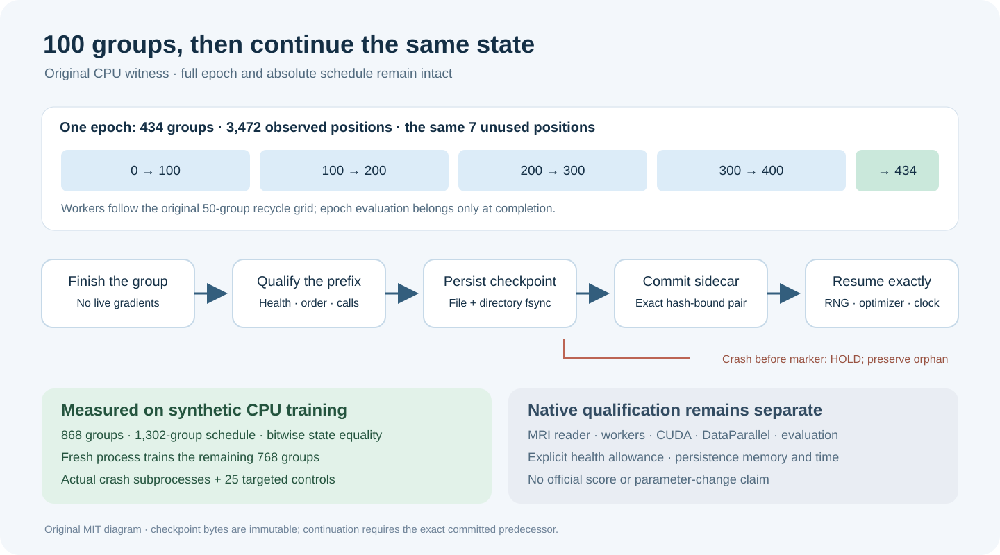

# 100 groups, the same CPU state

This original MIT utility makes a long training epoch resumable in registered chunks. A real synthetic PyTorch CPU experiment compares two epochs of434 groups with uninterrupted training, checkpoints at100/200/300/400/434, and fresh-process training of the remaining768 groups after the first checkpoint. Model, AdamW, scheduler, GradScaler, CPU/Python RNG, observed order, cumulative diagnostics and absolute DataLoader generations match bitwise in the retained CPU witnesses.



`chunk_recovery.py` provides an explicit chunk horizon, full ordered-permutation and consumed-prefix bindings, complete state capture/restore, permanent optimizer-observation taint, cumulative health admission and an append-only checkpoint store. Checkpoint bytes and directory entries are fsynced before a create-only, hash-bound sidecar commits the pair. Missing, torn or mismatched predecessors fail; there is no discovery scan, silent restart, replacement or cleanup. SHA256 pins establish integrity against the supplied reference; trusted origin/server binding remains the caller's responsibility.

The25 targeted controls cover missing allowances, wrong predecessor/source/geometry, same-count reordered data, changed unused-tail positions, incomplete accumulation, call-clock drift, callback failure, malformed sidecars and retries that preserve existing artifacts. Normal and optimized Python pass. Actual crash subprocesses before persistence and after checkpoint-only persistence are rejected; a crash after the sidecar commits retains a recoverable pair.

To reproduce on POSIX with Python and PyTorch2.8 installed, run in this directory using a fresh output path:

```bash
python -B run_cpu_witness.py --output ./my_cpu_witness
```

The runner uses nice+5 workers,90-second CPU caps and60-second wall caps; the fresh suffix has tighter60/45-second checks and crash workers have30-second wall caps. On an outer timeout it terminates only the new owned local CPU process group. A separate benign parent/child control verifies this branch; catastrophic parent/OS failure and children deliberately detaching from the group are outside the guarantee. The timeout control needs psutil. Every output is created exclusively and failures are retained. No credentials, network calls or competition data are needed.

These are CPU float32, single-thread, synthetic-data, workers0 results. DataLoader generations and seeds are exercised, but MRI decoding, multiprocessing workers, CUDA, DataParallel and OOF evaluation are untested. The handoff is explicitly the training boundary before evaluation. Declared health covers finite losses/gradients, observed calls/order and explicit cumulative build/missing allowances; it does not prove parameter changes or scan every saved tensor for finiteness. Native model/state health, reader equivalence, persistence memory/time and official scores require separate qualification. The synthetic allowance in the experiment is not a Knee allowance: missing native policy fails closed.

The first experiment failed because its runner attached repeated observers to one optimizer. Keeping one observer per optimizer lifetime fixed that error. A later independent review added saved-plan geometry validation; earlier evidence and all partial artifacts remain retained privately. The final receipts bind the reviewed implementation, not an inferred Kaggle score.
