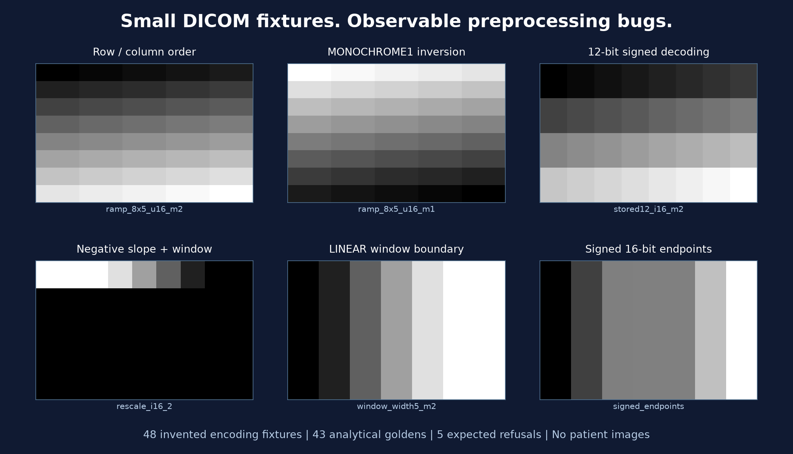
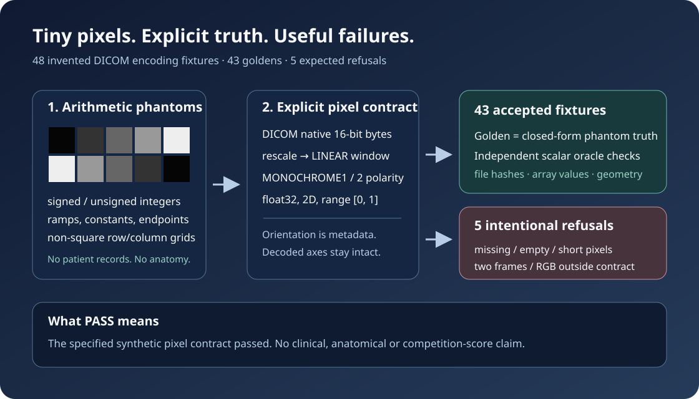

# Synthetic MRI DICOM Fixtures + Golden Arrays

**A small, inspectable regression corpus for single-frame MRI pixel readers.**
It pairs 48 invented DICOM encoding fixtures with 43 analytically defined
`float32` intensity arrays and five stable, intentional refusal cases. Every
pixel comes from a simple mathematical phantom. There are no patient images,
reports, labels, competition files, predictions, model weights or clinical
measurements here.





Use it to catch signed-pixel mistakes, silent transposes of non-square images,
incorrect `MONOCHROME1` polarity, rescale/window ordering errors, width-one
window errors, and readers that silently accept unsupported or incomplete
inputs. A complete run reads kilobytes per image and needs no GPU or network.
This is useful before a larger imaging pipeline is connected to clinical data.

The corpus is an original companion to the publisher's
[RSNA Knee Reader Code Pack](https://www.kaggle.com/datasets/prvsiyan/rsna-knee-reader-code-pack)
and the existing
[The Bee's Knees: Final RSNA Push notebook](https://www.kaggle.com/code/prvsiyan/the-bee-s-knees-final-rsna-push).
Those links provide project context; **none of their code, weights, images,
labels, predictions or measured results is copied into this dataset**. The
reader pack contains inference code and synthetic-test recipes; this release
has its own ready-to-read DICOM corpus, separate analytic oracle, golden arrays
and a deliberately narrow pixel contract. Passing these tests establishes only
that contract. It establishes no competition score or clinical performance.

## Start with the included corpus

Use Python 3.10 or later. The reference dependency pins are NumPy 2.2.6 and
pydicom 3.0.1; see `requirements.txt`. Third-party packages are dependencies,
not redistributed here.

```bash
python -m pip install -r requirements.txt
python verify_corpus.py corpus
python demo.py corpus
```

The verifier checks the physical file hashes and sizes, reconstructs every
accepted golden from independent scalar/rational formulas, compares the reader
with that truth, verifies row/column order and orientation metadata, and checks
all five refusal codes. It also checks signed/unsigned twin equivalence and the
sum of opposite photometric polarities. It deliberately refuses Python `-O`,
which would disable assertion-based checks. It does not write to the corpus.

For your own reader, replace the `read_fixture` import in a **copy** of
`verify_corpus.py` with an adapter returning `(float32_array, metadata)` and
map its intended refusal outcomes to the documented codes. Readers with a
different normalization, orientation, or multi-frame policy need an explicit
adapter; these goldens do not declare one universally correct MRI preprocessing
recipe.

To regenerate without changing the included corpus:

```bash
python generate_corpus.py --out corpus_regenerated --seed 20261013
python verify_corpus.py corpus_regenerated
```

`corpus_regenerated` must not exist and its parent must already exist. Every
write uses exclusive creation. An interrupted run stays in place for inspection;
use a new destination for another run. There is no overwrite, deletion, cleanup,
download or input-data ingestion path. The seed controls only the deterministic
synthetic UID namespace. All pixel arrays and analytic formulas are fixed.
Identical source, seed and pinned dependency versions should reproduce physical
files byte-for-byte; `generation.json` records the versions used.

## Exactly what is included

| Family | DICOMs | What its truth makes observable |
|---|---:|---|
| Row-major ramps | 16 | Four shapes, signed/unsigned 16-bit, both monochrome polarities |
| Rescale followed by window | 8 | Positive/negative slopes, intercepts, operation order, signed/unsigned equivalence |
| LINEAR window boundaries | 4 | Width 5 fractional boundaries and width 1 threshold, both polarities |
| Orientation metadata | 4 | Axial, sagittal, coronal and oblique direction cosines; decoded axes preserved |
| Constant images | 4 | Defined behavior when the intensity range is zero, both signs/polarities |
| 12 meaningful bits in 16-bit words | 4 | Signed/unsigned decoding with `BitsStored=12`, both polarities |
| Integer endpoints and zero slope | 3 | Full signed/unsigned 16-bit endpoints; constant output after rescale |
| Expected refusals | 5 | Missing, empty or short pixel bytes, two frames, RGB |
| **Total** | **48** | **43 accepted goldens + 5 explicit refusals** |

Shapes range from 1×5 to 16×16. The images are tiny arithmetic patterns, not
anatomical simulations. All files use Explicit VR Little Endian encoding.
The two-frame file contains complete bytes for two invented frames; it is
intentionally outside the example reader's single-frame contract. The RGB file
contains complete invented three-channel bytes and tests photometric refusal.
Missing/empty/truncated fixtures are deliberately invalid at the pixel contract
boundary. Their DICOM container remains readable for inspection.

The files are minimal synthetic encoding fixtures with `Modality=MR`, not a
claim of complete MR/Enhanced MR IOD conformance. They are unsuitable for PACS
ingestion, diagnostic review, training a disease model, or estimating real-world
failure rates. No real participant identifiers are sampled: the only patient
placeholders are literal `SYNTHETIC^PHANTOM` and `SYNTHETIC`. Geometry is invented.

## Pixel contract and independent truth

`fixture_reader.py` accepts native, single-frame, one-sample monochrome images,
with 16-bit words, `1 ≤ BitsStored ≤ 16`, and valid unit/orthogonal orientation
vectors. It preserves the decoded `(row, column)` array and returns orientation
as metadata; it does not reorient, resize, crop or assemble a volume.

1. Decode signed or unsigned stored pixels `p`.
2. Apply `x = slope × p + intercept` (defaults 1 and 0).
3. If a window is present, apply the specified LINEAR display contract:
   `clip((x − (center − 0.5)) / (width − 1) + 0.5, 0, 1)` for width > 1;
   for width 1, return 0 when `x ≤ center − 0.5`, otherwise 1.
   Otherwise use per-image min–max scaling; a constant image becomes zero.
4. For `MONOCHROME1`, return `1 − intensity`; `MONOCHROME2` keeps it.
5. Return a finite 2D `float32` array in [0, 1].

The LINEAR equation is documented in
[DICOM PS3.3, VOI LUT Module](https://dicom.nema.org/medical/dicom/current/output/chtml/part03/sect_C.11.2.html).
The min–max fallback and constant-image rule are choices of **this corpus**.

The oracle never calls the reader or decodes generated DICOMs. For a row-major
ramp with `N` samples, truth is exactly `j/(N−1)` or `(N−1−j)/(N−1)` at flat
index `j`. Width-five truth is `[0, 1/8, 3/8, 5/8, 7/8, 1, 1]`; width-one truth
is `[0, 0, 1, 1, 1]`. Combined rescale/window truths are clipped rational ramps
`(j+1)/8`, `(4j−13)/8`, `(13−2j)/8` and `(20−j)/16`.
Endpoint arrays have explicitly listed integer numerators over 65535. This makes
the positive and negative rescale magnitudes observable instead of allowing
them to cancel in min–max normalization. Saved goldens use those phantom
formulas before any DICOM encoding, and the separate verifier reconstructs them
with scalar arithmetic and explicit rational values.

| File | Expected refusal |
|---|---|
| `missing_pixels.dcm` | `MISSING_PIXEL_DATA` |
| `empty_pixels.dcm` | `EMPTY_PIXEL_DATA` |
| `truncated_pixels.dcm` | `TRUNCATED_PIXEL_DATA` |
| `multiframe_two.dcm` | `MULTIFRAME_UNSUPPORTED` |
| `rgb_unsupported.dcm` | `PHOTOMETRIC_UNSUPPORTED` |

Coverage is deliberately bounded. Compressed transfer syntaxes, modality LUT
tables, padding masks, multi-value windows, surplus pixel bytes, invalid geometry,
floating pixel elements, and complete clinical IOD validation are not exercised.
The reader has some defensive checks beyond these fixtures; those branches are
not evidence of tested coverage.

## Files and manifest schema

`corpus/dicom/` contains the 48 DICOM files; `corpus/golden/` contains the 43
`.npy` arrays (no object arrays/pickle). `corpus/manifest.csv` has one row per
DICOM, and `corpus/generation.json` records seed, source version and dependency
versions. Python scripts, license, citation and explanatory SVG are included.

| Manifest column(s) | Meaning |
|---|---|
| `case_id` | Stable synthetic case key within source version 1.0.0 |
| `dicom_path` | Relative path from the corpus directory |
| `dicom_sha256`, `dicom_bytes` | SHA-256 of the complete physical DICOM file and byte count |
| `rows`, `columns`, `frames` | Encoded geometry and frame count |
| `samples_per_pixel` | 1 for monochrome; 3 for the refusal-only RGB case |
| `bits_allocated`, `bits_stored`, `pixel_representation` | Word size, meaningful-bit count, and 0=unsigned / 1=signed |
| `photometric_interpretation` | `MONOCHROME1`, `MONOCHROME2`, or refusal-only `RGB` |
| `rescale_slope`, `rescale_intercept` | Effective numeric defaults included even when tags are absent |
| `window_center`, `window_width` | Blank means min–max contract; otherwise one numeric LINEAR window |
| `orientation` | Six semicolon-separated row/column direction-cosine values |
| `expected_contract` | Accepted float32/no-reorientation contract, or `refuse` |
| `expected_error` | Exact stable refusal code; blank for accepted cases |
| `oracle` | Named closed-form family used by the independent verifier |
| `golden_path`, `golden_sha256` | Relative `.npy` path and physical hash; both blank for refusal cases |

## Provenance, rights and citation

Original code, mathematical fixture designs, generated data, documentation and
SVG: **Copyright 2026 prvsiyan; MIT License**, granted in `LICENSE.txt`.
Nothing is extracted from RSNA, OAI/NDA, any public notebook or any clinical
record. The legacy reader pack is linked as context under its own license and
is not a source of this corpus. The Kaggle selector may display **Other**;
the explicit license covering this original release is MIT.

NumPy (BSD-3-Clause) and pydicom (MIT) are credited dependencies. They are not
vendored. See [NumPy](https://numpy.org/) and [pydicom](https://pydicom.github.io/).
The synthetic fixtures encode standard DICOM attributes; this does not grant
rights to any separate third-party data or model.

Citation: prvsiyan (2026). *Synthetic MRI DICOM Fixtures + Golden Arrays*,
version 1.0.0, Kaggle dataset `prvsiyan/rsna-knee-synthetic-dicom-fixtures`.
Machine-readable citation: `CITATION.cff`.

**Release validation:** run `verify_corpus.py` against the included corpus.
`PASS` means 43 analytic comparisons and five expected refusals were checked in
that invocation. It does not imply a clinical benchmark or broader DICOM
conformance. No score, timing or external-data claim is made by this release.

## Reproduce the preview

`golden-preview.png` shows six actual analytical arrays, rendered by `render_goldens.py`. Install the optional `requirements-figures.txt`, then run `python render_goldens.py corpus --out preview_regenerated.png` with a fresh output path. `VALIDATION.json` records the actual 43 comparisons, five expected refusals and byte-for-byte reproduction of all 93 corpus files. The core reader and verifier do not depend on Matplotlib.

Source and progress: https://github.com/cubres/rsna-knee-abnormality-detection/tree/main/datasets/synthetic-dicom-fixtures-v1
