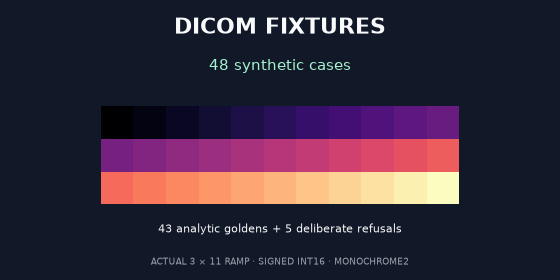

The synthetic DICOM fixture corpus is now [public on Kaggle](https://www.kaggle.com/datasets/prvsiyan/rsna-knee-synthetic-dicom-fixtures), dataset 12569105, version 1. The existing [The bee's knees notebook](https://www.kaggle.com/code/prvsiyan/the-bee-s-knees-final-rsna-push/log?scriptVersionId=358150421) completed version 38 on CPU with internet disabled and the dataset attached.

Its original companion verified all 48 synthetic DICOM cases: 43 independent analytic goldens and five expected refusal codes passed. The two preserved process-closure controls also passed. The displayed 35-second runtime covers the whole notebook, including setup and those controls; it is not a reader-speed benchmark. See `NATIVE_COMPANION_VALIDATION.json` for the exact native version and source hashes. Existing notebook identity, artwork and all 143 prior cells were preserved.

Use the invented ramps, integer endpoints and window boundaries to catch signed-pixel errors, non-square transposes, polarity mistakes and unsupported inputs before connecting a reader to larger imaging data. PASS establishes the corpus's narrow single-frame intensity/geometry contract. It does not establish clinical performance, general DICOM conformance or a competition score. No competition submission was made.

`companion.py` is byte-identical to the verified native demo cell. On Kaggle, attach the dataset and run that code. From this directory locally, with the dependencies in `requirements.txt` installed, use its existing directory override:

```python
import runpy
runpy.run_path("companion.py", init_globals={"_KNEE_FIXTURE_DATASET_ROOT": "."})
```



The cover plots an actual released golden array with the magma colour scale. It contains no patient image or AI artwork. `render_cover.py` is a portable adaptation of the script used for this PNG; install the optional `requirements-figures.txt` dependencies, then choose a new output file:

```bash
python render_cover.py --corpus corpus --out dataset-cover-reproduced.png
```

Rendering refuses to overwrite an existing output. The maintainer also ran this portable script successfully and reproduced the included 12,933-byte PNG byte for byte (SHA-256 `8da30cbdaba65a9eceb7b3ecf8c59e44cd2c33d821b5f6af7977120c7d86c3b7`). This is a reproduction check, not a rendering-speed benchmark. Original code, synthetic designs, data and documentation remain MIT-licensed. The [initial source release](https://github.com/cubres/rsna-knee-abnormality-detection/tree/36bd0508ed2dbbd395d07212fc7fddd3ade10899/datasets/synthetic-dicom-fixtures-v1) is preserved.
