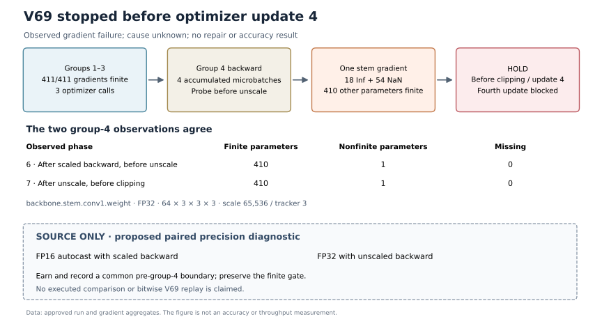

# V69 stopped before the fourth optimizer update

The private V69 diagnostic ended in native `ERROR` after a controlled finite-gradient gate recorded `HOLD_NATIVE_PILOT_GATE`. The owned child exited with code 2. This is a documented training failure: no evaluation, checkpoint export, competition submission, or official score was produced.



Groups 1–3 had 411 present, finite gradient parameters in both observed phases, and three optimizer calls were recorded. In accumulation group 4, snapshots 6 and 7, using zero-based indices, each recorded **18 Inf and 54 NaN elements** in `backbone.stem.conv1.weight`, with gradient shape `64 × 3 × 3 × 3` and dtype FP32. The other **410 parameters were finite**, with **zero missing gradients** among 411 observed parameters.

Snapshot 6 followed scaled backward and preceded unscaling. Snapshot 7 followed unscaling and preceded clipping. Both recorded the same nonfinite counts; the finite gate held before clipping and the fourth optimizer update. The GradScaler state was scale 65,536 with growth tracker 3. These observations localize the detected failure to one gradient tensor; **the cause remains unknown**. They do not establish AMP as its cause or demonstrate a repair.

The server reported 120.6 seconds for native session `357661407`, version 69. The owned-process receipt reported 114.830661 seconds and two Tesla T4 devices were reported. These clock scopes differ, and the run did not qualify a hardware-performance comparison or full training.

A proposed precision diagnostic remains **SOURCE_ONLY**: compare FP16 autocast with scaled backward against FP32 with unscaled backward from a common, earned pre-group-4 boundary. That boundary and its required state must be recorded for the new comparison. No executed comparison, successful fix, accuracy gain, or bitwise replay of V69 is claimed here; an exact replay would require V69's recorded boundary state. The finite gate remains mandatory.

`failure_aggregate.json` contains only approved run and gradient aggregates. Its receipt digest binds the observations to the privately retained evidence; raw receipts, patient identifiers, images, tensors, labels, weights, and private paths are excluded. The figure is original and generated from that aggregate by the MIT-licensed `plot_failure.py`; `LICENSE` covers the original packet code and diagram.

To reproduce the figure with Python and Matplotlib, use fresh output names:

```sh
python3 -I -B plot_failure.py --data failure_aggregate.json \
  --svg failure_flow_reproduced.svg --png failure_flow_reproduced.png
```

This command reads the public aggregate only. It does not train a model or access competition data.
