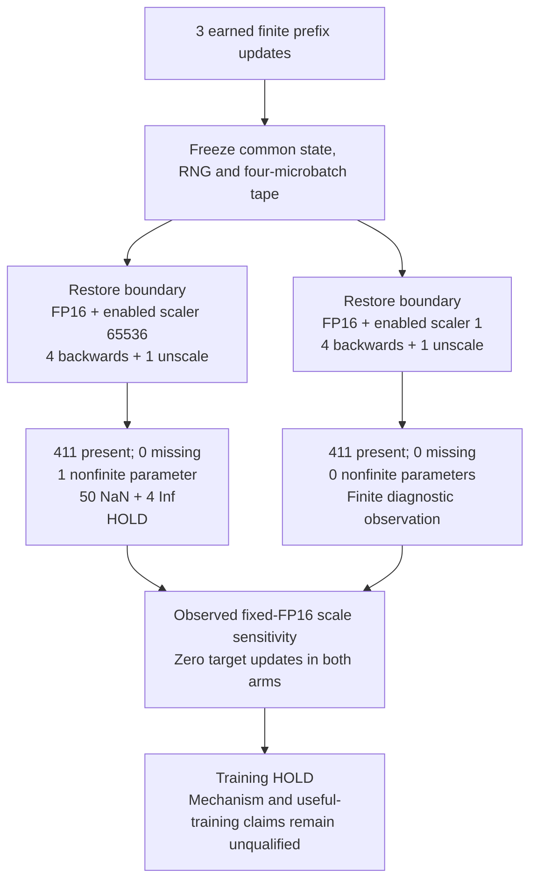

# FP16 precision lab: scale 65536 versus scale 1 at one frozen boundary

In version 72, the scale 65536 arm produced **50 NaNs and 4 Infs in one of 411 gradient parameters** after each target backward. The scale 1 arm had **all 411 gradients present and finite**, with zero missing gradients. Both arms kept FP16 autocast and enabled GradScaler. This is one source-bound diagnostic observation of scale sensitivity at fixed FP16.

Three finite prefix optimizer updates earned the boundary. Each arm restored the same full state, RNG and four-microbatch tape; only the restored public scaler scale changed. Each replay performed four backwards and one unscale, with **zero optimizer, scaler or scheduler updates**. All five forward summaries—inputs, targets, logits, loss and scaled loss—were finite in both arms at microbatches 13–16.

| Observation, at each microbatch13–16 | Scale65536 | Scale1 |
|---|---:|---:|
| Present / required gradient parameters | 411 / 411 | 411 / 411 |
| Missing gradient parameters | 0 | 0 |
| Nonfinite gradient parameters | 1 | 0 |
| NaN / Inf elements | 50 / 4 | 0 / 0 |
| Target optimizer / scaler / scheduler updates | 0 / 0 / 0 | 0 / 0 / 0 |

The same counts persisted after the single unscale. The nonfinite arm remained HOLD; the finite arm qualified only a complete gradient observation.

Native session 357998030 completed. Its hash-bound owner record completed after receipt fsync in **169.986419775 s**; the kernel UI reported **175.7 s**. These clocks have different start/end scopes and do not establish a speed or overhead comparison.

This pair does not prove an AMP/GradScaler causal mechanism, useful training, a precision-policy effect or an accuracy gain. Finite counts do not establish nonzero gradients or rule out underflow. Stem raw/detached tensor details remain unqualified. The diagnostic performed no target update, checkpoint export, evaluation or competition submission; no official score is claimed.

[scalar_summary.json](scalar_summary.json) contains the approved counts and exact source/protocol/registration/capture fingerprints. The evidence is privately retained; raw receipts, model/data/labels/tensors, private paths and upstream trainer code are excluded. The prose and Mermaid diagram are original project documentation.
