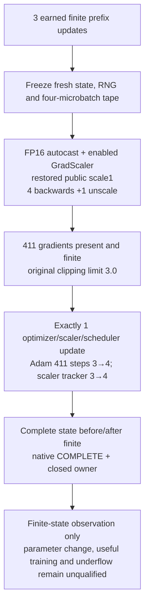

# FP16 precision lab companion: one scale-one fourth update

Version 73 completed one actual fourth optimizer update with FP16 autocast and enabled GradScaler at restored public scale 1. All 411 Adam parameter step counters advanced 3→4, the scaler growth tracker advanced 3→4, and the complete pre/post model, buffer, Adam, scaler, scheduler and loss state scans were finite. This qualifies one finite-state update observation.

Three earned finite prefix updates established a fresh boundary. The target replay used four microbatches 13–16, one unscale, the unchanged original gradient clipping limit 3.0, then exactly one optimizer, scaler and scheduler update. All five forward summaries and all 411 present gradients were finite after each target backward, after unscale and after clipping; no gradients were missing.

| Captured observation | V73 result |
|---|---:|
| Earned prefix / target optimizer updates | 3 / 1 |
| Target optimizer / scaler / scheduler updates | 1 / 1 / 1 |
| Adam parameters checked; steps | 411; 3→4 |
| Scaler growth tracker; public scale after update | 3→4; 1 |
| Gradient parameters present / missing | 411 / 0 |
| Nonfinite parameters; NaN / Inf elements | 0; 0 / 0 |
| Complete state scans before and after update | finite |

This follows the [V72 fixed-FP16 scale comparison](../2026-10-13-v72-fp16-scale-lab/README.md), whose two replay arms made zero target updates. V73 used the same registered data/seed recipe prospectively; it does not claim a bitwise match to V72's boundary or tape. These two versions have different diagnostic questions and are not a matched update-effect experiment.

Native session 358024320 completed. The hash-bound owner clock after receipt fsync was **170.836217774 s**; the kernel UI reported **178.5 s**. Different clock scopes preclude an overhead or speed claim.

A completed optimizer call and finite state do not prove that any parameter changed, that gradients avoided underflow, or that training is useful. No FP32 gradient-reference comparison was measured here. Raw/detached tensor details remain unqualified. There was no further update, continuation, checkpoint export, evaluation or competition submission; no official score is claimed.

The proposed next probe will compare one small selected gradient against a matched FP32 reference and measure the same parameter's actual pre/post change around one scale-one update. That design remains source-only and requires independent review before execution. [scalar_summary.json](scalar_summary.json) records the approved aggregates and immutable source/protocol/capture fingerprints. Raw evidence and trainer source remain private; this prose and diagram are original project documentation.
