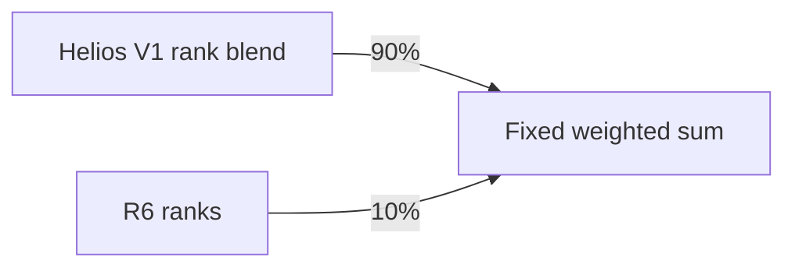

# V47: a fixed-weight public canary, with full scoring pending

**15 October 2026, 20:59 UTC snapshot.** [Bee V47](https://www.kaggle.com/code/prvsiyan/the-bee-s-knees-final-rsna-push?scriptVersionId=358804172) passed its three-study public canary. Its full competition attempt was accepted once as row `57243942`: the API showed `PENDING` at 20:57 UTC and the native UI showed “Notebook Running” at 20:59 UTC. There was no error or score. This is not a reproduced 0.957 result or an accuracy improvement.

The one scientific change is **90% of the Helios V1 rank blend plus 10% R6 ranks**, giving global weights **0.550 / 0.2925 / 0.1575** for R6 / Raptor384 / Raptor224. It shares the same arm predictions and checkpoints, adds no model passes, and uses no mirror averaging. The reviewed test-ID output alignment and bounded preprocessing corrections remain.



A runnable standard-library toy example illustrates the algebra, not inference:

```python
from math import isclose
r6, r384, r224 = 0.8, 0.2, 0.6  # invented rank values
baseline = 0.5*r6 + 0.325*r384 + 0.175*r224
candidate = 0.55*r6 + 0.2925*r384 + 0.1575*r224
assert isclose(candidate, 0.9*baseline + 0.1*r6)
print(round(baseline, 3), round(candidate, 3))  # 0.57 0.593
```

Independent output review confirmed three rows, 36 finite predictions, zero reported arm failures and a byte-exact baseline-control CSV. The changed blend altered 20 prediction values, with maximum absolute change 0.0333334; these are output differences, not accuracy measurements. Validated output was written after **471.344 seconds**; the native run reported **496.5 seconds**. Peak sampled process-group RSS was **21.35 GiB**. The canary used a 900-second / 28-GiB budget; the full attempt retains 29,880 seconds / 28 GiB.

Three public examples are not cross-validation or representative hidden-runtime evidence. Sampled host RSS is not a continuous memory maximum or GPU peak. The baseline-control check qualifies the blend comparison, not hidden performance. This single fixed hypothesis was not selected by a sweep over public leaderboard results.

Use the same public **V1** inputs; newer dataset versions are not interchangeable:

- [R6 four-fold bundle — rostigor](https://www.kaggle.com/datasets/rostigor/rsna-knee-r6-fe055406/versions/1)
- [Raptor weights — nartaa](https://www.kaggle.com/datasets/nartaa/rsna-knee-publication-swa-weights-20261007/versions/1)
- [Supporting bundle — Heliosli](https://www.kaggle.com/datasets/heliosli/rsna-orthofoundation-fold0-epoch7-20261004/versions/1)

Credit [Heliosli V1, native 358332966](https://www.kaggle.com/code/heliosli/this-is-new-version-0-9576-in-one-click?scriptVersionId=358332966), nartaa, dreaddevelopment, varshithakolupuri and rostigor. The [reproduction guide, licenses and OAI/NDA acknowledgement](../../tools/public0957-reproduction/2026-10-15/README.md#credits-and-use-conditions) remain applicable. [EVIDENCE.json](EVIDENCE.json) binds this snapshot. No weights, study records or labels are rehosted here.
