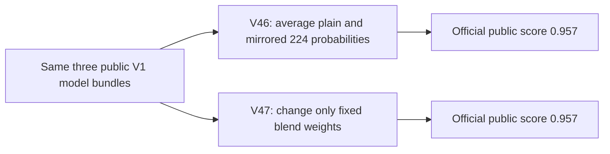

# V46 and V47: two official public scores of 0.957

**Verified 16 October 2026, 11:31 UTC.** Both experiments completed competition scoring. Each submission’s native details show **Succeeded — 0.957**, with its own exact notebook-version link; the API independently reports `COMPLETE`, the same public score and no error.

| Experiment | Scientific change | R6 / Raptor384 / Raptor224 rank weights | Accepted row | Public score |
| --- | --- | --- | --- | --- |
| [V46 · native 358794056](https://www.kaggle.com/code/prvsiyan/the-bee-s-knees-final-rsna-push?scriptVersionId=358794056) | Raptor224 anatomical mirror before intensity lookup; average plain/reflected probabilities | 0.500 / 0.325 / 0.175 | 57243233 | **0.957** |
| [V47 · native 358804172](https://www.kaggle.com/code/prvsiyan/the-bee-s-knees-final-rsna-push?scriptVersionId=358804172) | Fixed blend: 90% Helios V1 blend + 10% R6 ranks; no mirror or extra model passes | 0.550 / 0.2925 / 0.1575 | 57243942 | **0.957** |

These results establish successful full scoring for these two submitted versions. The scores match **at the displayed three-decimal precision**; that does not establish identical underlying scores or a reliable advantage for either change. No private score was returned. The three-study public canaries were functional checks, not cross-validation or proof of accuracy gains.

**Badge detail:** Kaggle’s notebook-wide “Public Score 0.957 Best Score” badge links to **V47**, including when viewing the V46 page. V46’s result is independently bound through its own successful submission details and exact native link; we do not attribute a separate V46 badge.

## Reproduce and inspect

- [V46 experiment and runtime corrections](../2026-10-15-v45-failure-v46-mirror-canary/README.md): mirror averaging, test-ID output alignment and bounded preprocessing. V45’s earlier failure cause remains unknown.
- [V47 fixed-weight canary](../2026-10-15-v47-fixed-weight-canary/README.md): runnable standard-library blend example and all three public V1 dataset links.
- [Reproduction tools and source binding](../../tools/public0957-reproduction/2026-10-15/README.md): exact upstream version, historical dataset versions, dependencies and public-example checks.
- [Evidence for this update](EVIDENCE.json): accepted rows, timestamps, source hashes and the badge distinction.

The earlier reports remain preserved as timestamped records of their then-pending attempts. This report adds the official outcomes; it does not replace notebook versions, opening artwork or prior evidence.

Credit [Heliosli’s public V1 source](https://www.kaggle.com/code/heliosli/this-is-new-version-0-9576-in-one-click?scriptVersionId=358332966), nartaa, dreaddevelopment, varshithakolupuri and rostigor. The [existing credits, licenses and OAI/NDA acknowledgement](../../tools/public0957-reproduction/2026-10-15/README.md#credits-and-use-conditions) apply. This report contains aggregate results and links, not model weights, study records or labels.
