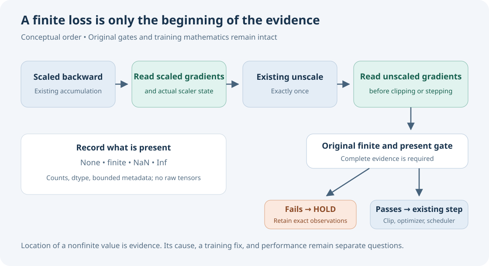

# When a finite loss still ends at the gradient gate

A small, original PyTorch diagnostic from a failed RSNA Knee training experiment. It distinguishes **missing (`None`), finite, NaN and Inf gradients** at two declared points: after scaled backward, and after unscale before clipping. It reads scalar summaries and scaler state without changing gradients, randomness, optimizer calls or training mathematics.



## The failure that motivated this tool

Our version 67 ended in **ERROR** after one observed finite-gradient optimizer group and one scheduler advance. Eight recorded losses were finite. The next accumulation group remained partial: the original all-required-gradient check failed **after unscale, before clipping and before the second optimizer/scheduler call**.

That gate combined `grad is None` with nonfinite gradients. The failed run did not export its actual scaler state. Consequently, it could not distinguish a missing gradient from NaN/Inf, and **AMP overflow was not established**. The root cause remains unconfirmed. No checkpoint qualified, no parameter-update proof was retained, and no official score or model-performance gain resulted from this experiment.

The successor diagnostic was prepared and checked as source only. Its 28 original controls inspected exact source bytes, AST structure and invented exit-status dictionaries; they did not run training. The helper had separately passed eight controls on invented CPU tensors. Those checks are evidence about instrumentation, not evidence that the failed training run was fixed. This public extraction has its own reproducible controls below.

## Run the controls

Requires Python 3.10+ and PyTorch. No competition files, weights, model, GPU, credentials or Kaggle API are needed. The controls were run with Python 3.12 and PyTorch 2.8.0 on CPU.

```sh
cd gradient-observation-2026-10-12
python -m unittest -v test_gradient_observability.py
```

## Insert observations around your existing unscale call

```python
from gradient_observability import capture

# Your existing loss, accumulation and scaled backward have completed.
scaled = capture(model, scaler, "after_scaled_backward_before_unscale")
scaler.unscale_(optimizer)  # Your existing call; do not add a second unscale.
unscaled = capture(model, scaler, "after_unscale_before_clip")

# Retain your original finite/present gate, clipping, step and scheduler.
# A partial observation is diagnostic evidence only; it cannot admit a step.
```

The observer records actual `get_scale()` and public `state_dict()` scalars, gradient dtype, missing/nonfinite counts, NaN/Inf element counts, finite absolute maxima, and bounded parameter metadata. Names are hashed; no raw weights or gradient arrays are copied to the result. A default 512-record cap limits detailed metadata while aggregate counting continues. The default 20-second wall budget is checked between reductions and after observation.

A missing gradient and a present nonfinite gradient require different investigation. Comparing two complete, correctly placed snapshots can localize where a nonfinite value was observed; it still does not identify its cause. Scaler scale alone is insufficient evidence of overflow. Record the exact phase and keep your existing training acceptance rules.

## Limits that matter

- No tensor correction, lower initial scale, precision change, skipped optimizer group, relaxed finite gate or recovery policy is implemented.
- Sparse or non-floating/non-complex gradients are explicitly unreviewed. An empty required-parameter collection cannot pass. Record truncation and a partial time-budget observation are reported separately.
- Scalar tensor reductions can synchronize CUDA and add overhead. A blocked device call can exceed the observation budget; only an external watchdog can bound such a call. These CPU controls establish neither GPU behavior nor training reproducibility.
- Hashing parameter names is pseudonymization, not an anonymity guarantee. Shapes and caller-supplied scaler state can describe your model. Review a real run's summaries before publishing them.

This is an additive companion to the [published optimizer-call witness](https://github.com/cubres/rsna-knee-abnormality-detection/tree/52023b65c4d4d8820c2a63137d79338a626d8448/optimizer-call-witness-2026-10-11). That packet observes optimizer/scaler call paths and includes an invented CPU AMP probe; this one separates missing/nonfinite gradients at the two observation phases. Neither packet claims a training fix.

## Provenance and reuse

[PROVENANCE.json](PROVENANCE.json) pins the original helper, the private source-only freeze and the exact private failure disposition by SHA256. It records the extraction and the earlier publication inspected for overlap. The private receipts themselves, training wrapper and upstream model implementation are not redistributed. This directory contains only original generic code, invented controls, documentation and a hand-written conceptual SVG. It contains no patient/study/task identifiers, labels, medical matrices, weights, signed URLs, raw native outputs or private datasets. Existing notebook identities and opening artwork remain intact.

All six files in this directory are original project material under the [MIT license](LICENSE). The diagram shows observation order; it is not a measured result or generated opening artwork.
