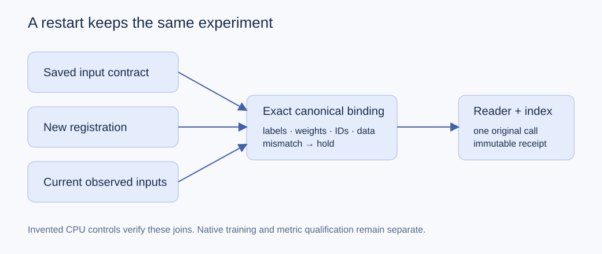

# Keep the experiment fixed across a restart

A fresh registration can accidentally bless changed labels, loss weights, record order or data while loading an old experiment. This small original utility compares the current inputs with both the saved contract and the explicit new registration. It compares canonical bytes, so a Boolean dimension cannot alias an integer dimension.

`IndexedStudyDataset` retains the reader’s three values and adds its actual absolute record index. Optional ordered IDs bind that index to the registered namespace. The base reader runs once per requested index. `create_only_receipt` writes a new JSON artifact, fsyncs the file and directory, and checks the bytes; retries and partial files remain untouched.



```python
import factor_join as fj
saved = fj.input_bindings(labels, weights, ordered_ids, data_sha256)
registered = dict(saved)
fj.validate_registered_inputs(saved, registered, labels, weights, ordered_ids, data_sha256)
dataset = fj.IndexedStudyDataset(base_three_tuple_dataset, ordered_ids)
ref = fj.create_only_receipt('new_evaluation.json', {'declared_metric': 0.4})
```

Install PyTorch and run `python -B test_factor_join.py --output fresh_controls`. The retained normal and optimized-Python receipts each cover 21 targeted controls, one actual invented CPU minibatch, and an observed AdamW parameter change. The fixture contains nine invented records and two invented findings.

The utility checks declared bindings. A caller-provided hash is a provenance pin, not authentication; a recorded metric remains caller-declared. It does not select checkpoints, restore RNG, prove MRI/data-reader or CUDA equivalence, recompute a real metric, or qualify a native training run. The tests do not claim separate-process training continuation. No competition records, native profiles or model weights are included.

All failures and partial artifacts are preserved. Use fresh owned JSON paths; notebook metadata is rejected. Catastrophic operating-system or filesystem failure remains outside the normal successful fsync/readback guarantee.
