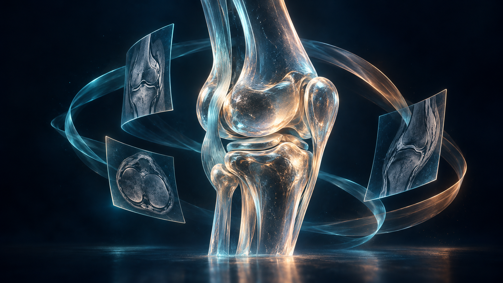
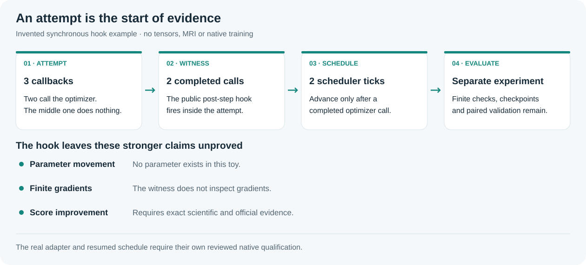

## Before training: count the calls that happened

A tiny experiment you can run before spending a GPU hour.


*AI-generated concept art: glass knee anatomy and imagined scan-like panels. These are not patient images or measured MRI.*

A batch counter can advance even when mixed precision skips an optimizer call. Before comparing losses, ask whether the two runs performed the same number of calls. This companion demonstrates that question without MRI, weights or a GPU.

### A five-minute learning path

1. Read the active notebook’s geometry and reproduction sections first. They explain what the checkpoint expects.
2. Run the invented hook example below. Inspect attempts, completed calls and scheduler calls separately.
3. For a training fork, freeze patient partitions, initializer exposure, label masks and loss weights before measuring a change. Add instrumentation only to a separately reviewed experiment.


*Evidence grows in stages; no arrow is a score claim.*

### The smallest counterexample

The toy optimizer announces a completed call twice. Its middle callback does nothing. No tensor exists, so a completed call clearly cannot mean “the weights improved.” The witness ticks the toy scheduler only twice.

```python
optimizer = ToyOptimizer()  # synchronous hook protocol; no tensors
witness = tool.OptimizerCallWitness(optimizer)
witness.attempt(optimizer.step, scheduler_tick)
witness.attempt(lambda: None, scheduler_tick)  # skipped call
witness.attempt(optimizer.step, scheduler_tick)
print(witness.snapshot())
```

| Attempt | Callback completed a call? | Scheduler ticks so far |
| --- | --- | --- |
| 1 | Yes | 1 |
| 2 | No | 1 |
| 3 | Yes | 2 |

Executed result: 3 attempts, 2 completed optimizer calls, 1 skipped call, 2 scheduler calls. The helper leaves parameter_change_proven and gradient_finiteness_proven false. This is a simulated hook protocol, not a native PyTorch or CUDA test.

### The training contract worth writing down

| Boundary | Record privately | Why it matters |
| --- | --- | --- |
| Data | Patient partitions, known-label masks, initializer exposure | A study split alone can retain the same patient or pretraining exposure. |
| Updates | Consumed order, actual call counts, finite checks, scheduler state | Attempted batches do not prove completed optimizer calls. |
| Checkpoint | Weights plus optimizer, scaler, schedule and resume contract | A weights-only reload cannot reproduce an interrupted trajectory. |
| Evaluation | Frozen supported findings and untouched selection policy | A reused panel is a diagnostic, not fresh independent validation. |

### Run and fork locally

Obtain the pinned helper and this companion from the campaign repository. Python 3.10+ and the standard library suffice for this toy. It writes no file, calls no network service and needs no competition access.

```sh
python3 -I -B toy_example.py --tool /your/path/optimizer_call_witness.py
```

The full toy implementation is in toy_example.py; the excerpt above uses its ToyOptimizer and a scheduler_tick callback. Compare the program output with EXAMPLE_RESULT.json. Do not insert this toy into Run All or infer an overflow in an earlier Knee run from its invented skipped call.

### A useful next fork

Keep one qualified control continuation first. Then compare one intervention with control-derived fixed loss weights and the same data/initialization contract. Hook counts, real memory samples and exact terminal artifacts help decide whether the experiment finished; a paired scientific comparison is still required to decide whether it helped.

### Version, evidence and provenance

Companion revision 1 · 11 October 2026. The reviewed official inventory at 18:27 UTC recorded the account’s best completed public row as 57043015, score 0.949. This scalar snapshot is separate from the toy. It does not establish that this companion or its helper improved the score.

[Existing Kaggle notebook](https://www.kaggle.com/code/prvsiyan/the-bee-s-knees-final-rsna-push) · [Campaign GitHub repository](https://github.com/cubres/rsna-knee-abnormality-detection) · [Pinned original helper](https://github.com/cubres/rsna-knee-abnormality-detection/blob/52023b65c4d4d8820c2a63137d79338a626d8448/optimizer-call-witness-2026-10-11/optimizer_call_witness.py) · [Helper guide and limits](https://github.com/cubres/rsna-knee-abnormality-detection/blob/52023b65c4d4d8820c2a63137d79338a626d8448/optimizer-call-witness-2026-10-11/README.md)

Helper commit: 52023b65c4d4d8820c2a63137d79338a626d8448. Source SHA256: 8a890ea67cd8382d31d7b2a98d78ecf45b6604cc9b1eb284ba769737b1a5eef3. Dependency details are in DEPENDENCIES.json; the runnable example checks the source digest before loading it. No internet installation occurs in the toy.

Original companion prose, toy code and diagrams are MIT licensed. The license grants no rights to competition data, checkpoints, organizer or competitor implementations, or branding. The generated opening artwork is illustrative and its exact prompt and bytes are recorded in ARTWORK_PROVENANCE.json. Keep the current artwork and all earlier assets unchanged until the user requests a change.
