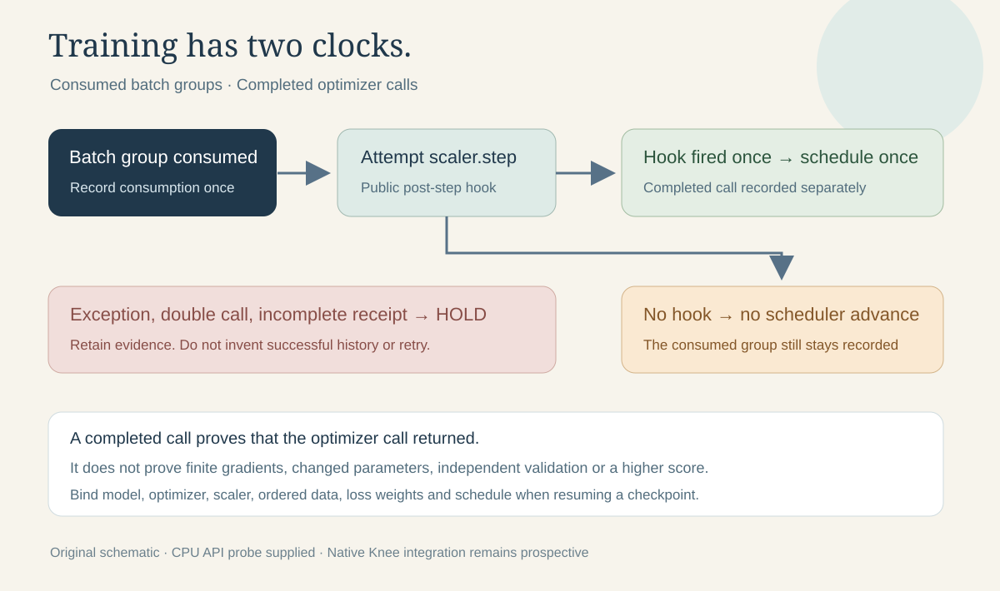

# When a training step did not happen



Mixed precision can consume a batch group while skipping its optimizer call.
If a loop always advances its learning-rate scheduler, its batch counter and
optimizer history diverge. This small original helper records both histories
and advances the scheduler only after the optimizer's public post-step hook
actually fires. It never loads model weights or accesses Kaggle.

The motivation is concrete: the inspected Knee training source calls
`scaler.step(optimiser)`, then advances its scheduler and batch-group counter
unconditionally. This is a **source-level risk**, not evidence that an overflow
occurred in a Knee run. The CPU example below deliberately creates one overflow
to make the difference reproducible.

## Run the examples

The helper and its invented controls need Python 3.10 or later. The CPU example
also needs PyTorch with CPU `torch.amp.GradScaler` and optimizer post-step hooks.
The published example was measured on PyTorch **2.8.0**, with one CPU thread.

```bash
python -B -m unittest -v test_optimizer_call_witness
python -B -O -m unittest -v test_optimizer_call_witness
python -B cpu_amp_probe.py
```

The observed finite → infinite → finite toy sequence was:

| Loop | Batch groups consumed | Completed optimizer calls | Scheduler calls | LR after the skipped call |
|---|---:|---:|---:|---:|
| Unconditional scheduler fixture | 3 | 2 | 3 | 0.025 |
| Hook witness | 3 | 2 | 2 | 0.050 |

The skipped call changed neither toy parameter in either loop. The witness also
kept its scheduler unchanged for that call. This result checks a real CPU API;
it does not validate CUDA, dual-device `DataParallel`, or a Knee model. The
machine-readable toy evidence is [CPU_AMP_PROBE_R2.json](CPU_AMP_PROBE_R2.json).

## Integrate prospectively

Attach the witness immediately after constructing the optimizer. In an already
reviewed accumulation loop, the relevant section would become:

```python
from optimizer_call_witness import OptimizerCallWitness

witness = OptimizerCallWitness(optimizer)
# Inside the accumulation boundary, after unscale and finite-gradient checks:
outcome = witness.attempt(lambda: scaler.step(optimizer), scheduler.step)
scaler.update()
optimizer.zero_grad(set_to_none=True)
call_evidence = witness.snapshot()
```

This is an integration proposal. The active Kaggle candidate was not edited.
Keep consumed batch groups separate from completed optimizer calls in the
checkpoint, receipt and resumed schedule. Existing checkpoints cannot be given
invented hook history. Record missing history honestly, and assess an existing
run using its actual artifacts. Do not silently reset training to acquire the
new evidence.

An optimizer post-step hook proves that the call returned. It **does not prove
parameter movement**, finite gradients, useful learning, correct loss masks,
or independent validation. A zero learning rate or zero gradient can produce
an unchanged parameter after a completed call. The helper explicitly leaves
these stronger claims false. It is designed for synchronous callbacks and one
owning thread; custom optimizers and asynchronous code require separate review.
Exceptions permanently taint the witness, and it supplies no retry mechanism.

The optional `continuation_report` checks a normalized caller-supplied envelope:
completed native status, full declared batch coverage, coherent call/scheduler
counts, and explicit declarations of finite checks and checkpoint-contract
binding. Its result is `DECLARED_CONTINUATION_CONTRACT_PASS` or `HOLD`. It does
not authenticate the declarations or open a checkpoint. A `RUNNING` receipt or
an old receipt without a witness is never sufficient for this narrow contract.
Other training protocols can deliberately allow skips through `max_skips`; the
default allows none. This policy is a prospective choice, not a diagnosis of a
historic run.

## What changed in the Knee diagnosis

The previous canary exit mismatch is repaired in the inspected control source:
seven isolated exact-entrypoint controls returned zero for `PASS_CANARY`,
`PASS_EPOCH`, and `PASS_TRAINED`, and two for the tested HOLD/FAIL/absent cases.
The locally retained native Version 62 receipt contains `PASS_CANARY` and two
completed training-step stages. These are canary observations, not a completed
full epoch or an official competition score.

The retained Version 63 receipt ends during group 182, with 181 completed groups
of 434 and no memory trace. Its native log later reports `Killed`; the campaign
ledger diagnoses host OOM, but that receipt does not expose an OOM-event counter
or measured resident-memory trajectory. The source successor reduces loader
staging to uint8, recycles workers and adds memory sampling and checkpoints.
These changes are present in source; this packet has no terminal successor
receipt proving that they resolved the native failure.

The current offline analyzer was also reproduced on that incomplete Version 63
receipt: it still emitted the recommendation “B2 can follow.” A missing slope
or absence of a recorded hold is not a continuation certificate. Fresh terminal
status, exact checkpoint/sidecar/source binding and a complete epoch remain
necessary before evaluating the successor. The separate normalized envelope
checker demonstrates a conservative alternative without changing the runner.

The highest-value immediate training arm is a **qualified control continuation**:
first bind the actual predecessor's complete epoch or declared mid-epoch resume
point, inspect native memory samples, preserve its consumed order and cosine
schedule, and confirm that resumed optimizer/scaler state matches that contract.
After that, a label-only variant with **control-derived fixed prevalence
weights** would isolate target changes. The prepared variants currently
recompute those loss weights from each target table, changing two factors at
once. This proposal has no GPU result yet and needs a separate preregistration.

Fold-0 and the gold diagnostic set inherit exposure from the all-data
initializer. They are useful regression panels, not fresh independent estimates
of generalization. No score improvement, patient-disjoint claim, or new
checkpoint qualification is asserted by this packet.

The inspected three-epoch cosine with floor 0.1 gives factors **0.775** at
one-third and **0.325** at two-thirds. Stopping after two trained epochs does
not change that curve into a two-epoch schedule. The ending 0.325 factor corrects
the separate ledger shorthand of 0.25; it is arithmetic from the pinned source.

## References and reuse

The implementation and diagram are original MIT-licensed work. No third-party
notebook code, medical records, study identifiers, labels or checkpoint bytes
are included. [PROVENANCE.json](PROVENANCE.json) pins the privately inspected
sources and records the public packet's limits.

PyTorch documents both [optimizer post-step hooks](https://docs.pytorch.org/docs/2.10/generated/torch.optim.Optimizer.register_step_post_hook.html)
and [GradScaler's skipped-call behavior](https://docs.pytorch.org/docs/2.10/notes/amp_examples.html).
The API example was verified on the locally installed version stated above;
the campaign's CUDA 2.10 runtime still requires its own native probe.
