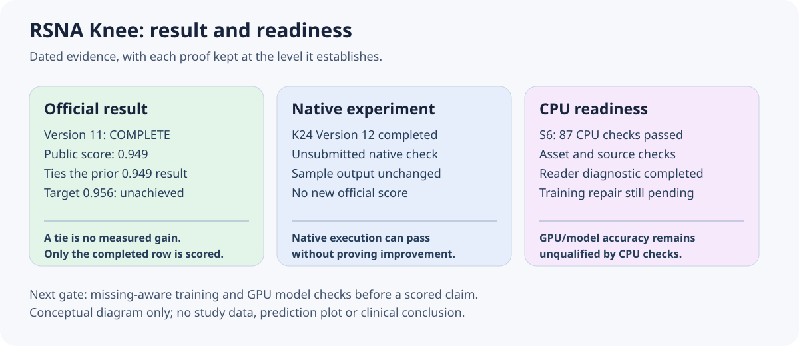

# RSNA Knee progress — 2026-10-11

Our Version 11 submission completed with a public score of **0.949**, tying the existing **0.949** result. The **0.956** research target remains unachieved. This is a completed official result; it establishes no score improvement or new rank claim.

The retained row is submission `57083743`, submitted by `prvsiyan` to [RSNA Knee Abnormality Detection](https://www.kaggle.com/competitions/rsna-knee-abnormality-detection), status `COMPLETE`, nonempty `publicScore` `0.949`, read on 2026-10-11T20:31:29.097480+00:00. The incumbent comparison is our completed row `57043015`, also `0.949`. [STATUS.json](STATUS.json) retains this narrow public projection; raw receipts remain private.

The K24 Version 12 native experiment passed its recorded execution gates but remained unsubmitted in the bound qualification. Its sample CSV was unchanged, so that sample check supplies no gain evidence. This result cannot establish hidden runtime, independent accuracy or a completed official score for the experiment.

S6 Version 13 passed 87 checks in the exact fourth CPU qualification: eight mounted assets, six safe primitive state summaries and six byte-bound helper exports were checked. This is CPU asset/source readiness. It does not establish a real encoder forward pass, GPU behavior, training, model quality, or permission to redistribute the source/weights. No helper implementation or checkpoint is included in this progress note.

An eight-case native reader diagnostic completed. Missing-aware training repair remains pending; the reader observations did not qualify the old training policy or produce a trained checkpoint. Keep missing-input handling distinct from both decode success and model learning.

A useful reproduction sequence is to bind inputs and assets, check the missing-data contract, verify a real model forward/backward step on the intended device, complete the declared native run, and then inspect an exact completed official row. These are gates to perform, not results claimed by this note. Preserve existing versions and artifacts while testing an additive repair.

The prose and diagram are original; the diagram is conceptual rather than a measured scientific plot. This addendum contains no study identities, private labels/predictions, copied implementation or weight release. Existing opening art stays unchanged. These statements describe the pinned observations above and may be superseded by later dated progress.

[Campaign repository](https://github.com/cubres/rsna-knee-abnormality-detection) · [Existing public campaign notebook](https://www.kaggle.com/code/prvsiyan/the-bee-s-knees-final-rsna-push)
