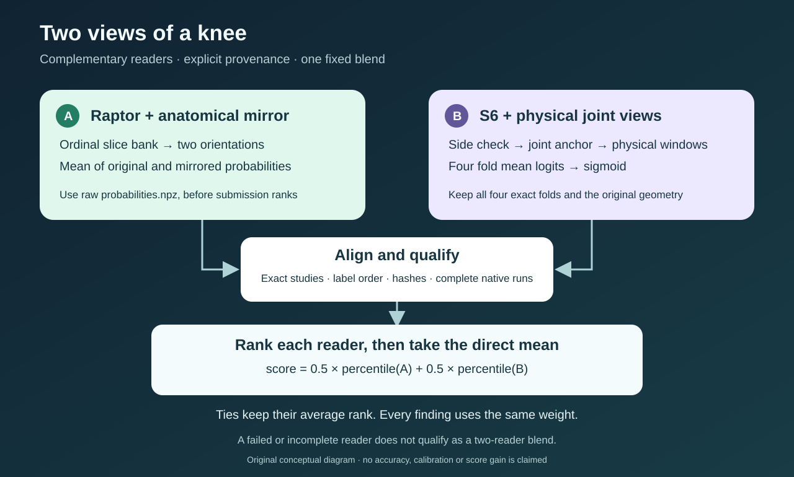

# Two views of a knee, one fixed blend

Raptor and S6 look at the same examination in different ways. Raptor reads an ordinal slice bank twice, once in its original orientation and once through an anatomical mirror. S6 uses physical coordinates, a joint anchor and side correction to build its windows. Their diversity is the reason to test a blend.

The proposed blend is deliberately small: rank each model's probabilities independently within each finding, then average the two percentile tables with weight **0.5**. Ties receive their average rank. We do not tune a different weight for each finding, and we do not rank Raptor's already ranked submission a second time: its `probabilities.npz` provides the raw mirror-averaged probabilities.

The account's verified Knee best remains **0.949**. [Heliosli's public blend notebook](https://www.kaggle.com/code/heliosli/blend-mine-in-private-lb-luck-to-all-upvoters?scriptVersionId=357284025) displays **0.956** for Version 1. Its scored source points to an older compact bundle and describes an S6 plus DINO student component. The current released version points to a different four-S6-fold bundle. This packet studies that four-fold route and has no scored blend result; the Version 1 result is not evidence that substituting four S6 folds reproduces 0.956.

For one finding, let `L` be the number of smaller probabilities and `T` the number of equal probabilities. The percentile is `(L + (T + 1)/2) / N`. This definition preserves ties. The final value is the direct mean of the Raptor and S6 percentiles; it is a ranking score, not a calibrated disease probability.

The original helper in `fixed_half_rank_blend.py` accepts complete probability tables, aligns their study rows and checks their label order. Its Raptor loader also checks the raw artifact hash, selected checkpoint, reader source, mirror probability mean and complete native receipt. A component with decoding errors, missing rows or fallback predictions cannot qualify as this blend. The final helper writes a new directory, CSV and receipt without replacing an earlier result.

To reproduce an experiment, first save both exact component artifacts and their native receipts. Bind their source versions, checkpoint hashes, input metadata, complete study set and runtime. Only then call the fixed blend. Record the resulting CSV hash and any official submission separately. A local file or notebook completion does not supply an official score.

The current public Knee reader source is `e9ec648e…`; the separately qualified benchmark reader is `96af4b84…`. They use the same selected Raptor checkpoint, but this packet does not assume their predictions are identical. The actual reader hash belongs in the experiment binding.

The S6 specification references the original public model bundle and its four folds. This packet contains original mathematics, glue and diagrams; it does not republish implementation modules or weights. A full native runner needs an explicitly licensed source version or a separately written implementation with framework and checkpoint attribution. Its geometry, strict state loading and predictions still need native comparison before use.

Useful next forks are a fixed control versus a new physical sampling rule, or an original model implementation versus its source-bound native reference. Keep the same subjects, checkpoint, input contract and failure policy in a comparison. Public-model design and leaderboard exposure should remain visible in the experiment log; those comparisons are not untouched validation panels.

Credits: nartaa / Danial Zakaria for the selected anatomical-mirror Raptor checkpoint, dreaddevelopment for Raptor, Heliosli for the S6 bundle and fixed blend, arjundd and the SKM-TEA authors for the separately distributed V-Net anchor, and the timm and MONAI authors for their frameworks. Checkpoint use, code use and redistribution have separate terms; no whole-bundle Apache grant is asserted here.
