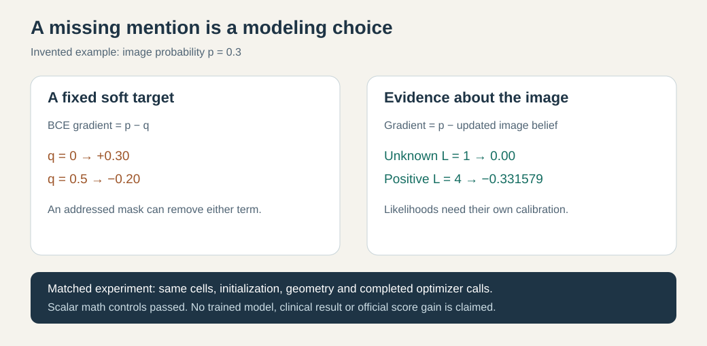

# Learning when a report leaves a finding unstated

A knee MRI can show a finding that its clinical report does not mention. “Not mentioned” needs its own representation: training against a negative target, a probability of one half, and no evidence are three different choices.

The ordinary missing-label mask is already part of our prospective paired study. This note explores the next mathematical distinction: a fixed soft target describes a target distribution, whereas a report’s likelihood ratio describes evidence about an image prediction. The calculation below is independently derived from Bayes’ rule; it is an educational prototype, not a fitted model or score improvement.

For image probability p and report evidence ratio L=P(report|finding)/P(report|no finding), the relative negative log likelihood is

    loss(p,L) = -log((1-p)+p*L)
    gradient with respect to image logit z = sigmoid(z)-sigmoid(z+log(L))

A factor depending only on the report can be omitted when computing gradients. Consequently this relative loss can be negative without invalidating the gradient. L=1 supplies no evidence and produces exactly zero gradient. At p=.3, invented positive evidence L=4 produces gradient -0.331579. By comparison, ordinary BCE gives gradient +0.3 for a negative target and -0.2 for a one-half target.

Neither representation establishes the right likelihood ratio. Converting a labeler’s posterior q to evidence requires its base prior π and calibration: log(L)=logit(q)-logit(π). Arbitrary report probabilities do not automatically meet that requirement. Reports may also be missing in a way that depends on disease, clinical practice or language; masking alone does not remove that bias.

A useful experiment compares explicit addressed-BCE and evidence likelihood on the same observed cells, with the same initialization, training rows, image geometry, completed optimizer calls and final-checkpoint rule. Both arms keep unaddressed cells neutral. Likelihoods and priors must be documented from training-only sources before the comparison. Evaluation on report-derived labels measures agreement with those labels; it does not establish clinical accuracy or an official competition gain.

The original scalar controls cover neutrality, gradient direction, numerical derivatives, finite extreme values and a direct Bayes identity. They ran normally and under Python -O. No visual model was trained. Native precision, calibrated likelihoods, image execution and official score effects remain unqualified.

The research context is the newer public compact-reader family, whose authors combine richer report states with spatially structured image sampling. These are several changes together; their reported outcome cannot isolate this particular loss. Source credit belongs to [Heliosli’s public notebook](https://www.kaggle.com/code/heliosli/blend-mine-in-private-lb-luck-to-all-upvoters) and its [versioned model manifest](https://www.kaggle.com/datasets/heliosli/rsna-knee-compact-v1/versions/13). The [organizer’s clinical overview](https://www.kaggle.com/competitions/rsna-knee-abnormality-detection/discussion/733343) explains why image findings and clinical reports can differ.

This note contains no model weights, patient records, report text or competition-derived counts. It grants no rights to upstream checkpoints. Our current official result and independent research are tracked separately.

