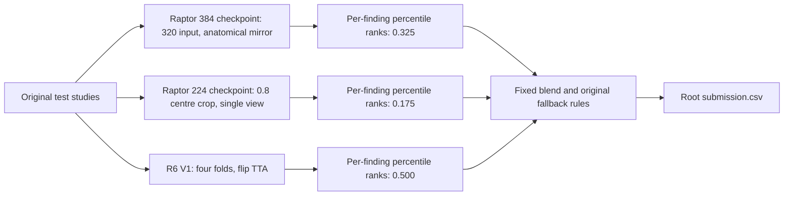

# Reproducing the public 0.957 Knee blend

The starting point is [Heliosli's exact public V1](https://www.kaggle.com/code/heliosli/this-is-new-version-0-9576-in-one-click?scriptVersionId=358332966): its visible score badge is **0.957**, linked to V1. The title's additional digit is unverified. This was the strongest complete public candidate verified in our bounded search, not proof of leaderboard optimality. Our own verified result remains **0.949**; this guide reports no reproduced improvement.

The useful experiment is faithful reproduction before tuning: preserve the upstream models, preprocessing, inference order, fixed weights, and fallback logic. The observed 7m38s T4×2 execution covers the public three-study input; it does not establish full hidden-test runtime.

## Pin the inputs, especially historical R6 V1

| Original mount | Required version and role |
| --- | --- |
| [Heliosli R6 frozen weights](https://www.kaggle.com/datasets/heliosli/rsna-knee-r6-frozen-fe055406/versions/1) | **V1**, bundle `fe055406fad6a12f`: four fold models, `state_spec.json`, and their own fluid/state stackers. Latest V2 substitutes R7 models under the same filenames. |
| [nartaa public SWA weights](https://www.kaggle.com/datasets/nartaa/rsna-knee-publication-swa-weights-20261007/versions/1) | V1; contains both Raptor checkpoints. |
| [Heliosli auxiliary code and anatomy model](https://www.kaggle.com/datasets/heliosli/rsna-orthofoundation-fold0-epoch7-20261004/versions/1) | V1; code, offline dependencies, and `anatomy.pt`. The ConvNeXt route does not execute the conditional OFL weight-parts branch. |
| [RSNA Knee competition](https://www.kaggle.com/competitions/rsna-knee-abnormality-detection/data) | Original competition `test.csv` and test imagery. |

R6 V1 and Raptor V1 were confirmed in the exact source notebook's native input views. Auxiliary V1 was confirmed through public dataset metadata; its native input version was not separately observed. Check it before execution.

The original source is nine cells, 615,840 bytes, SHA-256 `16a9d953972d9d82717f279f75e57e798d3902f93d1071c30f3caa67326e3601`. The [historical R6 V1 manifest](https://www.kaggle.com/api/v1/datasets/download-raw/heliosli/rsna-knee-r6-frozen-fe055406/manifest.json?datasetVersionNumber=1) has SHA-256 `6508ce6921eda986c885b2226fa55dd4d2aa8e5fc570b4c007c9a60c05bfc648`. Dataset names alone do not pin these bytes.

## Preserve the recipe and execution order

- **Raptor384:** retain the [anatomical-mirror inference](https://www.kaggle.com/code/nartaa/rsna-knee-0949-anatomical-mirror). Despite the checkpoint's “384” label, its scored inference uses `INPUT_RES=320` and paired anatomical views.
- **Raptor224:** retain the [224-crop inference](https://www.kaggle.com/code/nartaa/rsna-knee-0945-efficient-224crop): a 0.8 central crop of the 384-pixel field, resized to 224, one view.
- **R6:** four ConvNeXt-small folds, size 384/crop 352, V4 views, stride 1, three slices and 3.5 mm spacing. Every fold also scores reflected windows; swap medial/lateral outputs back, average in logit space, and retain MCL from the plain pass. Preserve R6's own stackers.
- **Blend:** `0.500 × rank(R6) + 0.325 × rank(Raptor384) + 0.175 × rank(Raptor224)`, per finding, retaining each arm's successful-row ranking and the exact fallback rules. Do not tune these weights against the public leaderboard.

Run **both Raptor stages before installing the R6 offline wheels**. Reordering changes the environment seen by the earlier stages. Preserve offline `timm==1.0.25` and `pydicom==3.0.1`; the actual mounted wheel byte hashes still require capture. The source image digest is `2757e0c7d1e0a9cb43da657b97e223c321a98f5014bdf64f44f2f6b083ad2b2f`; use the recorded T4×2, GPU-on, TPU-off, internet-off configuration.

## Qualify a canary before a full run

Start with one three-study canary under a 15-minute budget. Check every arm, exact checkpoint/manifest hashes, complete row and column coverage, finite nonconstant predictions, zero unexpected fallbacks, GPU/dtype behavior, and the final `submission.csv` at the output root. The upstream permissive fallback ceilings are not canary acceptance targets.

Only a passing canary can support a runtime estimate from measured stage timings and study lengths. R6 flip TTA plus the additional 224 arm makes an older R7 runtime estimate unsuitable. Full runtime remains unknown; preserve the source's 8.3-hour stop and the remaining 0.7-hour validation margin within the nine-hour limit. Use one coordinator and one active run. A public three-study commit is a canary, not a full evaluation or a new score.

## Interpret validation honestly

In our earlier fine-tuning validation audit, separate from this R6 V1 reproduction, the selected initializer had already trained on the nominal held fold, and the gold set had been reused for checkpoint selection. Excluding the fold during a later fine-tune does not undo earlier exposure; relabeling the gold set “diagnostic” does not restore independence. Those scores are non-regression diagnostics and cannot establish a causal benefit for this blend. This is not a finding about R6 V1's training lineage. Study-level partitioning also does not prove patient separation; no actual patient leak is asserted here. This reproduction supplies no clinical validation or diagnostic-use claim.

## Credits and use conditions

Credit **Heliosli** for the blend and R6 recipe; **nartaa** for both public Raptor checkpoints and inference scripts; **dreaddevelopment** for the [Raptor recipe and baseline](https://www.kaggle.com/datasets/dreaddevelopment/raptor-knee-widedense); and **varshithakolupuri** for the [224-slot contribution](https://www.kaggle.com/code/varshithakolupuri/rsna-knee-one-unused-checkpoint-lifts-the-0-956). Weak-label work credits [stevenleehans](https://www.kaggle.com/datasets/stevenleehans/rsna-knee-llm-report-labels), [pilkwang](https://www.kaggle.com/datasets/pilkwang/rsna-knee-llm-labels), and [riadmohamed42](https://www.kaggle.com/code/riadmohamed42/jev-knee-labels-verification); the CoAtNet backbone comes from timm.

The notebook source is Apache 2.0. Dataset metadata uses “Other (specified in description)”; that is not a blanket checkpoint redistribution grant. Use original public mounts and retain their terms. Raptor's description permits credited noncommercial adaptation/redistribution with the acknowledgement below. This guide redistributes no weights, patient images, reports, or study-level labels. Follow the [competition rules](https://www.kaggle.com/competitions/rsna-knee-abnormality-detection/rules).

Required OAI/NDA acknowledgement, retained from upstream:

> Data and/or research tools used in the preparation of this manuscript were obtained and analyzed from the controlled access datasets distributed from the Osteoarthritis Initiative (OAI), a data repository housed within the NIMH Data Archive (NDA). OAI is a collaborative informatics system created by the National Institute of Mental Health and the National Institute of Arthritis, Musculoskeletal and Skin Diseases (NIAMS) to provide a worldwide resource to quicken the pace of biomarker identification, scientific investigation and OA drug development. Dataset identifier(s): 10.15154/0hcg-f676.

[Shared NDA Study](https://nda.nih.gov/study.html?id=3407) · [Dataset DOI](https://doi.org/10.15154/0hcg-f676) · [Official acknowledgement guidance](https://nda.nih.gov/nda/manuscript-preparation).
