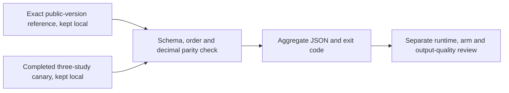

# Compare a canary without publishing study identifiers

`validate_canary_parity.py` is an original standard-library checker for one narrow question: do a three-study canary's predictions match an independently acquired, exact-version public reference CSV? It reads two local CSVs and prints aggregate JSON. It does not run inference, contact Kaggle, create a submission, or write either input.

Start with the [reproduction guide](README.md), which pins [Heliosli's public V1](https://www.kaggle.com/code/heliosli/this-is-new-version-0-9576-in-one-click?scriptVersionId=358332966), source SHA-256 `16a9d953972d9d82717f279f75e57e798d3902f93d1071c30f3caa67326e3601`, and its **R6 dataset V1**. Latest R6 dataset V2 contains different R7 models under the same filenames. The upstream visible score is 0.957; our verified score remains 0.949. This packet records no new canary result or score.

## Try the synthetic checks

From this directory, with Python 3.9 or later:

```bash
python3 -B validate_canary_parity.py --self-test
```

The 19 built-in cases use invented identifiers and in-memory CSV strings. They cover exact equality, numeric serialization changes, the inclusive tolerance boundary, high-precision deviations, schema/order errors, duplicate identifiers, invalid numbers, and nonfinite predictions. `SYNTHETIC_SELF_TEST.json` preserves the recorded **19/19 PASS** result for this exact script. Packaging did not rerun a canary or compare real predictions.

The synthetic result starts with:

```json
{"status": "PASS", "tests": 19, "passed": 19}
```

## Compare locally

Acquire the reference from the exact completed source version and independently bind its output SHA-256. Keep both CSVs local, then run:

```bash
python3 -B validate_canary_parity.py CANARY.csv REFERENCE.csv
```

The filenames above are placeholders. **No reference CSV, prediction table, or study identifier is included in this package.** The checker enforces:

| Contract | Required value |
| --- | --- |
| Rows | Exactly 3 |
| Columns | Exact ordered `StudyInstanceUID` plus the 12 finding names in the source |
| Identifiers | Nonblank, unique, and exactly equal in order across both files |
| Predictions | Numeric, finite, and in `[0, 1]` |
| Numeric parity | All 36 absolute differences at most `1e-7`, inclusive, using decimal arithmetic |

Exit code **0** means the requested check passed; **1** means validation failed; **2** means invalid invocation or an input-read error. The JSON report contains file hashes, shape/count summaries, the maximum numeric difference, and generic error codes. It does not emit identifiers or individual predictions. `byte_equal` is separate from numeric parity: equivalent numeric serialization may pass with different file hashes.

The checker does not establish reference authenticity. A SHA-256 computed from an arbitrary reference is only that file's fingerprint; the caller must bind it to the intended public version independently. It reads complete files into memory and is intended for these small, trusted CSVs, not hostile or unbounded inputs.

## Keep the result in scope



Parity alone does not check preprocessing, per-arm fallback rates, GPU memory, stage timing, or whether predictions vary meaningfully. Identical constant predictions can pass. Preserve those separate canary checks from the guide, and do not treat three-study agreement as a hidden-test score, a full-runtime guarantee, a causal improvement, or clinical validation.

Original checker and tooling explanation: cubres contributors, 2026, MIT; see [CODE_LICENSE.txt](CODE_LICENSE.txt). The separate reproduction guide retains upstream credits and the required OAI/NDA acknowledgement. The code license grants no rights in caller-supplied data or upstream checkpoints.
