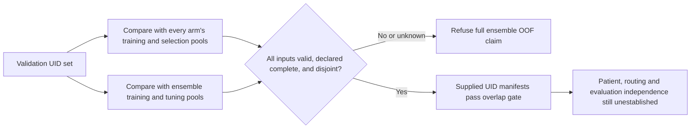

# Study UID exposure audit

This original, offline Python tool checks whether validation study identifiers occur in any contributing arm's training or checkpoint-selection manifests, or in ensemble training/tuning manifests. Reports contain aggregate counts and fixed reason codes. They contain no identifiers, hashed identifiers, paths, arm names, labels or model predictions.



Run the deterministic invented-data demonstration with Python 3.9 or later on Linux or macOS:

```sh
python synthetic_demo.py
```

Run an audit of your own local UID-only manifests:

```sh
python overlap_audit.py manifest.json
```

The tool prints JSON to stdout. Exit 0 means the supplied, declared-complete UID sets pass this overlap gate. Exit 2 means refusal or invalid input. It never labels an ensemble OOF: even a clean result says `NOT_ESTABLISHED_BY_UID_AUDIT`. Study UID disjointness alone does not establish patient disjointness, truthful lineage, prediction routing, independent labels or untouched evaluation. No numerical score or improvement is inferred.

## Input contract

Every CSV must have exactly one `StudyInstanceUID` column, UTF-8 encoding (optional BOM), and one nonempty unique UID per row. UIDs remain exact strings: leading zeros are preserved; whitespace is rejected rather than silently normalized. Duplicate UIDs, malformed rows, unreadable inputs and resource limits block the audit. A different header may be set with `uid_column`.

All relative CSV paths resolve beside the JSON manifest. Nothing is downloaded. The schema is:

```json
{
  "schema_version": 1,
  "uid_column": "StudyInstanceUID",
  "validation_csv": "validation.csv",
  "arms_complete": true,
  "arms": [
    {
      "training": {"complete": true, "csv": "arm_1_training.csv"},
      "selection": {"complete": true, "csv": "arm_1_selection.csv"}
    },
    {
      "training": {"complete": true, "csv": "arm_2_training.csv"},
      "selection": {"complete": false}
    }
  ],
  "ensemble_training": {"complete": true, "csv": "stacker_training.csv"},
  "ensemble_selection": {"complete": true, "csv": "ensemble_tuning.csv"}
}
```

The example deliberately refuses qualification because arm 2 selection exposure is unknown. `complete: true` is an explicit caller assertion, not something this tool can prove. A known empty pool needs a header-only CSV and `complete: true`. Omitting a manifest or declaring it incomplete never means zero exposure. `arms_complete` must cover every contributing checkpoint, encoder and model. Arm numbers in the report follow manifest order; names are not accepted or echoed.

Use `training` for gradient training, representation/pretraining exposure and fitted meta-models as applicable. Use `selection` for checkpoint/epoch selection, label revision, calibration, blending weights, threshold choice and other evaluation-driven tuning. Ensemble-level pools capture fitted stackers and cross-arm decisions. Union and deduplicate each exposure pool before exporting it; duplicates across separate arms are valid. An overlap in **any** contributing pool refuses a full-ensemble OOF claim, even when the other arms are disjoint.

This audit conservatively compares every arm with the whole supplied validation set. It assumes the same listed arms contribute to that validation batch. For fold-dependent prediction routing, audit each routed validation subset with its actual contributing checkpoints, and separately verify complete routing coverage. Do not pass a union of all fold models and call the resulting conservative overlap count proof of prediction leakage. Nor may a clean per-subset audit substitute for route and model lineage evidence.

The tool bounds the manifest to 1 MiB, each CSV to 16 MiB and 250,000 rows, each UID to 256 UTF-8 bytes, and the ensemble to 64 arms. It holds the validation UID set and one pool at a time. Inputs must be regular files; nonblocking open and descriptor checks reject FIFOs and devices. Platforms lacking this facility refuse the audit. Unexpected inputs produce fixed refusal codes rather than input-bearing exception messages. Freeze input manifests during an audit; this tool does not provide a transactional filesystem snapshot or a network-filesystem time limit. Aggregate reports are intended for provenance review, not access control or privacy guarantees about arbitrary surrounding shell commands.

## Source-bound Knee context

The dataset context was captured from the linked public dataset cards and sources on 2026-10-15. `PROVENANCE.json` records the scope of this original tool and its validation. This tool did not read or redistribute any real UID, label, report, image, prediction or weight.

| Public asset | Exact version and declared license | Useful role and limitation |
| --- | --- | --- |
| [Steven Lee Hans report-label release](https://www.kaggle.com/datasets/stevenleehans/rsna-knee-llm-report-labels/versions/6) | Dataset 11549447, version 6; card declares CC0: Public Domain | Weak training targets and label coverage. The card documents 4,407 studies and 58 gold studies; these counts were not independently counted from CSVs. Gold58 was used to compare label revisions/blends. Release version 6 is distinct from the `llm_labels_v4_blend.csv` filename. |
| [Pilkwang report-label release](https://www.kaggle.com/datasets/pilkwang/rsna-knee-llm-labels/versions/1) | Dataset 11529209, version 1; card declares CC0: Public Domain | Labeler provenance, scores/confidences/verdicts. A different labeler on the same study population does not create a held-out population. No CSV hashes or observed row counts were qualified. |

The source audit ties Helios R6 to four folds, a 4,344-study weak-target pool and Gold58 exclusion from gradient training. The [publication Raptor discussion](https://www.kaggle.com/competitions/rsna-knee-abnormality-detection/discussion/746792) describes training on 4,349 report-labeled competition studies plus 2,399 OAI knees, and Gold58 reuse for checkpoint selection. Thus R6 held-fold predictions blended with overlapping Raptor weights cannot be presumed full-ensemble OOF, and Gold58 cannot be relabeled untouched solely because gradient training excluded it. These are source-audit statements, not results from executing this tool on real manifests.

The inspected [NTejas source commit](https://github.com/NTejas-1/RSNA-Knee-Abnormality-Detection/tree/1c386ac71385ba7683f550b87a465386ba6c36a8) is a separate fold/schema example with different encoders and checkpoint selection on validation folds. Its authored code/checkpoint MIT notice does not establish OOF-table redistribution rights or matching Helios features.

CC0 label-card declarations do not grant rights to underlying competition images/reports or OAI data. Preserve each source's attribution and scope; consult the [competition data terms](https://www.kaggle.com/competitions/rsna-knee-abnormality-detection/data). This package includes original code, documentation and invented fixtures only, under MIT. It does not qualify a feature cache, native runtime, score gain or leaderboard submission.
